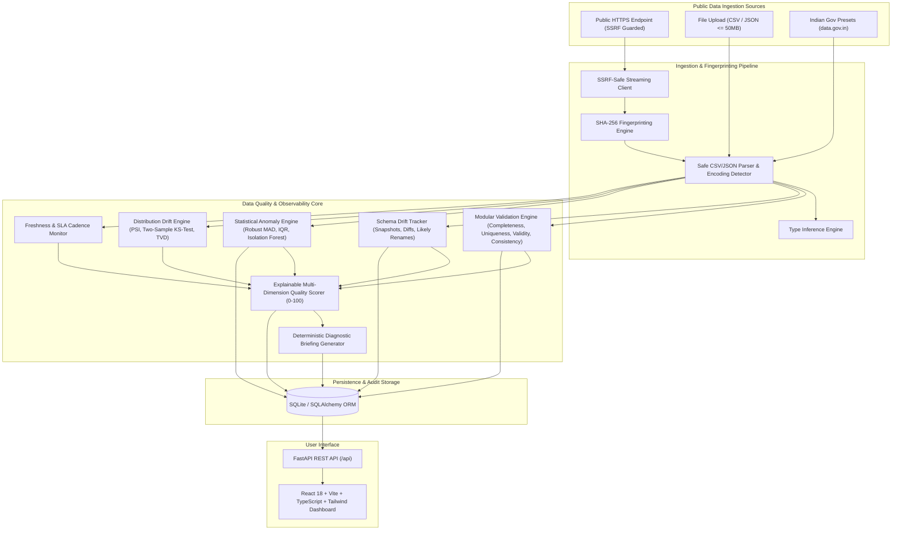

# OpenData Sentinel — Technical Architecture

## 1. System Overview

OpenData Sentinel is an AI-powered data reliability and quality monitoring platform designed specifically for public sector and open government datasets. Rather than acting as a passive dashboard or business intelligence viewer, OpenData Sentinel operates as an automated, active data observability pipeline that performs deterministic validation, statistical anomaly detection, schema drift tracking, and distribution shift detection across data lifecycles.

---

## 2. Component Design

### 2.1 Ingestion & Security Guard (`backend/app/services/ingestion.py`, `backend/app/core/security.py`)
- **Server-Side Request Forgery (SSRF) Guard**: All remote URLs are parsed and resolved via DNS. Destination IP addresses belonging to private networks (RFC 1918: `10.0.0.0/8`, `172.16.0.0/12`, `192.168.0.0/16`), loopback (`127.0.0.0/8`, `::1`), link-local/cloud metadata endpoints (`169.254.169.254`, `metadata.google.internal`), or multicast are strictly blocked before connection attempts.
- **Size & Timeout Protection**: Downloads are limited to 50MB with a 15-second timeout and streaming byte counters.
- **Fingerprinting**: Every dataset snapshot generates a SHA-256 cryptographic checksum. Unchanged datasets are distinguished from failed runs.

### 2.2 Validation Engine (`backend/app/services/validation.py`)
Executes six distinct check suites:
1. **Dataset Structure**: Non-empty validation, extraneous unnamed index columns (`Unnamed: 0`), and empty column checks.
2. **Completeness**: Missing cell rates, fully blank rows, and column missingness against configurable thresholds (30% warning, 70% failure).
3. **Uniqueness**: Full row duplicates and primary key identifier uniqueness.
4. **Data Types**: Inferred types against expected schemas, and corrupted numbers (e.g. numeric columns mixed with invalid text characters).
5. **Validity & Domain Bounds**: Non-negative quantity validation (prices, bed counts, hospital attendance) and chronological date validity.
6. **Referential & Cross-Field Consistency**: Domain relationships (e.g. `min_price <= max_price`, `icu_beds <= total_beds`).

### 2.3 Statistical Anomaly Detection (`backend/app/services/anomaly_detection.py`)
Provides explainable, transparent detection for numerical fields:
- **Robust MAD (Median Absolute Deviation)**:
  $$\text{MAD} = \text{median}(|x - \text{median}(x)|)$$
  $$\text{Modified } Z = \frac{0.6745 \cdot |x - \text{median}(x)|}{\text{MAD}}$$
  Threshold: $\text{Modified } Z > 3.5$.
- **Tukey's IQR Outlier Detection**:
  $$\text{IQR} = Q_3 - Q_1$$
  $$\text{Bounds} = [Q_1 - 1.75 \cdot \text{IQR}, Q_3 + 1.75 \cdot \text{IQR}]$$
- **Isolation Forest**:
  Non-parametric tree-based ensemble from Scikit-Learn configured with $N=100$ estimators and median imputation guardrails for multivariate feature spaces.

### 2.4 Distribution Drift Engine (`backend/app/services/drift_detection.py`)
- **Population Stability Index (PSI)**: Quantile-binned distribution comparisons between baseline and current runs with standard stability benchmarks:
  - $\text{PSI} < 0.10$: Stable
  - $0.10 \le \text{PSI} < 0.25$: Moderate Shift
  - $\text{PSI} \ge 0.25$: Significant Drift Alert
- **Two-Sample Kolmogorov-Smirnov (KS) Test**: Non-parametric test computing maximum empirical CDF distance ($D$) and asymptotic $p$-value.
- **Categorical Shift**: Total Variation Distance (TVD) and new/disappearing category tracking.

### 2.5 Explainable Quality Scoring (`backend/app/services/quality_scoring.py`)
Aggregates six dimensions into a normalized 0–100 score:
- Completeness (25%)
- Validity (25%)
- Uniqueness (15%)
- Schema Conformance (15%)
- Consistency (10%)
- Freshness (10%)
- **Critical Penalty Capping**: If critical integrity failures occur (e.g. primary key duplication, schema breaking removals, inverted price bounds), the overall score is capped at 58% to prevent masking severe errors behind an average score.
